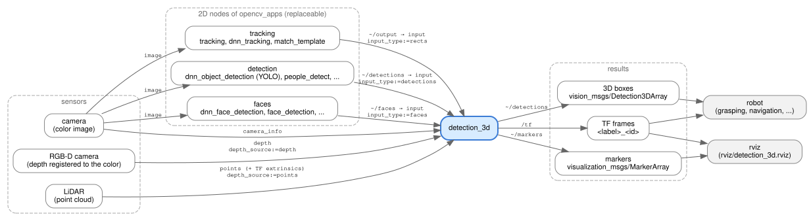

# opencv_apps

[](https://github.com/ros-perception/opencv_apps/actions/workflows/ci.yml)
[](https://ros-perception.github.io/opencv_apps/)
[](package.xml)

[](https://index.ros.org/p/opencv_apps/#jazzy)
[](https://index.ros.org/p/opencv_apps/#kilted)
[](https://index.ros.org/p/opencv_apps/#lyrical)
[](https://index.ros.org/p/opencv_apps/#noetic)
[](https://ros.packages.techfak.net/)

opencv_apps provides the ROS nodes that run the functions of [OpenCV](https://opencv.org/): image processing,
features, contours, optical flows, tracking, detection and recognition, and the deep learning models of `cv::dnn`.
Each node subscribes an image topic, and publishes its results as messages and as an image, so you can use the
functions of OpenCV just by running a launch file. The same source supports both ROS 1 and ROS 2.

```bash
sudo apt install ros-$ROS_DISTRO-opencv-apps ros-$ROS_DISTRO-image-publisher
# ROS 2, terminal 1: publish the USB camera as image (0: the number of the camera, /dev/video0)
ros2 run image_publisher image_publisher_node 0 --ros-args -r image_raw:=image
# ROS 2, terminal 2: the face detection on it
ros2 launch opencv_apps face_detection.launch.xml image:=image
# ROS 1 (ROS One), terminal 1: publish the USB camera as camera/image_raw (0: /dev/video0)
rosrun image_publisher image_publisher 0 __name:=camera
# ROS 1 (ROS One), terminal 2: the face detection on it
roslaunch opencv_apps face_detection.launch image:=camera/image_raw use_opencv4:=true
```

**Documentation: https://ros-perception.github.io/opencv_apps/** (the topics, the parameters and the usage of the
nodes)

## What opencv_apps can do

The nodes are grouped by what they find, e.g. what the whole image shows (image classification), the bounding boxes of
the objects (object detection) or the regions of the pixels (segmentation). The nodes of a group publish the same kind
of results, mostly the same type of message on the same topic, so that one can replace another, e.g. `face_detection`
by `dnn_face_detection`. Each group lists the nodes by the distributions that they run on, and each tile shows the
main output of the node.

<!-- gallery begin, generated by doc/tools/generate_pages.py -->
### Image filters

Filter and transform the images: edges, histogram equalization, morphology, image pyramids, smoothing, thresholds and the Fourier transform. Output: the processed image in `~/image`.

**ROS 1: noetic and later, ROS 2: jazzy and later**

<table>
<tr>
<td align="center" width="25%"><a href="https://ros-perception.github.io/opencv_apps/nodes/adding_images.html"></a><br><a href="https://ros-perception.github.io/opencv_apps/nodes/adding_images.html"><code>adding_images</code></a><br><sub>~/image</sub></td>
<td align="center" width="25%"><a href="https://ros-perception.github.io/opencv_apps/nodes/discrete_fourier_transform.html"></a><br><a href="https://ros-perception.github.io/opencv_apps/nodes/discrete_fourier_transform.html"><code>discrete_fourier_transform</code></a><br><sub>~/image</sub></td>
<td align="center" width="25%"><a href="https://ros-perception.github.io/opencv_apps/nodes/edge_detection.html"></a><br><a href="https://ros-perception.github.io/opencv_apps/nodes/edge_detection.html"><code>edge_detection</code></a><br><sub>~/image</sub></td>
<td align="center" width="25%"><a href="https://ros-perception.github.io/opencv_apps/nodes/pyramids.html"></a><br><a href="https://ros-perception.github.io/opencv_apps/nodes/pyramids.html"><code>pyramids</code></a><br><sub>~/image</sub></td>
</tr>
<tr>
<td align="center" width="25%"><a href="https://ros-perception.github.io/opencv_apps/nodes/smoothing.html"></a><br><a href="https://ros-perception.github.io/opencv_apps/nodes/smoothing.html"><code>smoothing</code></a><br><sub>~/image</sub></td>
<td align="center" width="25%"><a href="https://ros-perception.github.io/opencv_apps/nodes/threshold.html"></a><br><a href="https://ros-perception.github.io/opencv_apps/nodes/threshold.html"><code>threshold</code></a><br><sub>~/image</sub></td>
</tr>
</table>

**ROS 1: ROS One and later, ROS 2: jazzy and later**

<table>
<tr>
<td align="center" width="25%"><a href="https://ros-perception.github.io/opencv_apps/nodes/equalize_histogram.html"></a><br><a href="https://ros-perception.github.io/opencv_apps/nodes/equalize_histogram.html"><code>equalize_histogram</code></a><br><sub>~/image</sub></td>
<td align="center" width="25%"><a href="https://ros-perception.github.io/opencv_apps/nodes/morphology.html"></a><br><a href="https://ros-perception.github.io/opencv_apps/nodes/morphology.html"><code>morphology</code></a><br><sub>~/image</sub></td>
</tr>
</table>

### Features and shapes

Find the corners, the lines and the line segments, the circles and the blobs, and the contours with their bounding shapes, moments and convex hulls. Output: `~/corners` (Point2DArrayStamped), `~/lines` (LineArrayStamped), `~/circles` (CircleArrayStamped) and `~/contours` (ContourArrayStamped, `~/hulls` of convex_hull), by the kind of the features.

**ROS 1: noetic and later, ROS 2: jazzy and later**

<table>
<tr>
<td align="center" width="25%"><a href="https://ros-perception.github.io/opencv_apps/nodes/corner_harris.html"></a><br><a href="https://ros-perception.github.io/opencv_apps/nodes/corner_harris.html"><code>corner_harris</code></a><br><sub>~/corners</sub></td>
<td align="center" width="25%"><a href="https://ros-perception.github.io/opencv_apps/nodes/goodfeature_track.html"></a><br><a href="https://ros-perception.github.io/opencv_apps/nodes/goodfeature_track.html"><code>goodfeature_track</code></a><br><sub>~/corners</sub></td>
<td align="center" width="25%"><a href="https://ros-perception.github.io/opencv_apps/nodes/hough_lines.html"></a><br><a href="https://ros-perception.github.io/opencv_apps/nodes/hough_lines.html"><code>hough_lines</code></a><br><sub>~/lines</sub></td>
<td align="center" width="25%"><a href="https://ros-perception.github.io/opencv_apps/nodes/hough_circles.html"></a><br><a href="https://ros-perception.github.io/opencv_apps/nodes/hough_circles.html"><code>hough_circles</code></a><br><sub>~/circles</sub></td>
</tr>
<tr>
<td align="center" width="25%"><a href="https://ros-perception.github.io/opencv_apps/nodes/find_contours.html"></a><br><a href="https://ros-perception.github.io/opencv_apps/nodes/find_contours.html"><code>find_contours</code></a><br><sub>~/contours</sub></td>
<td align="center" width="25%"><a href="https://ros-perception.github.io/opencv_apps/nodes/general_contours.html"></a><br><a href="https://ros-perception.github.io/opencv_apps/nodes/general_contours.html"><code>general_contours</code></a><br><sub>~/contours</sub></td>
<td align="center" width="25%"><a href="https://ros-perception.github.io/opencv_apps/nodes/contour_moments.html"></a><br><a href="https://ros-perception.github.io/opencv_apps/nodes/contour_moments.html"><code>contour_moments</code></a><br><sub>~/contours</sub></td>
<td align="center" width="25%"><a href="https://ros-perception.github.io/opencv_apps/nodes/convex_hull.html"></a><br><a href="https://ros-perception.github.io/opencv_apps/nodes/convex_hull.html"><code>convex_hull</code></a><br><sub>~/hulls</sub></td>
</tr>
</table>

**ROS 1: ROS One and later, ROS 2: jazzy and later**

<table>
<tr>
<td align="center" width="25%"><a href="https://ros-perception.github.io/opencv_apps/nodes/line_segment_detector.html"></a><br><a href="https://ros-perception.github.io/opencv_apps/nodes/line_segment_detector.html"><code>line_segment_detector</code></a><br><sub>~/lines</sub></td>
<td align="center" width="25%"><a href="https://ros-perception.github.io/opencv_apps/nodes/blob_detection.html"></a><br><a href="https://ros-perception.github.io/opencv_apps/nodes/blob_detection.html"><code>blob_detection</code></a><br><sub>~/circles</sub></td>
</tr>
</table>

### Segmentation

Divide the image into regions by the class of each pixel: the pixels in a range of colors, the foreground, the connected regions, and the classes of a DNN. Output: the mask or label image, `~/image` of the color filters and background_subtraction, `~/label` of dnn_semantic_segmentation, and `~/contours` (ContourArrayStamped) of the regions of segment_objects and watershed_segmentation.

**ROS 1: noetic and later, ROS 2: jazzy and later**

<table>
<tr>
<td align="center" width="25%"><a href="https://ros-perception.github.io/opencv_apps/nodes/hsv_color_filter.html"></a><br><a href="https://ros-perception.github.io/opencv_apps/nodes/hsv_color_filter.html"><code>hsv_color_filter</code></a><br><sub>~/image</sub></td>
<td align="center" width="25%"><a href="https://ros-perception.github.io/opencv_apps/nodes/hls_color_filter.html"></a><br><a href="https://ros-perception.github.io/opencv_apps/nodes/hls_color_filter.html"><code>hls_color_filter</code></a><br><sub>~/image</sub></td>
<td align="center" width="25%"><a href="https://ros-perception.github.io/opencv_apps/nodes/rgb_color_filter.html"></a><br><a href="https://ros-perception.github.io/opencv_apps/nodes/rgb_color_filter.html"><code>rgb_color_filter</code></a><br><sub>~/image</sub></td>
<td align="center" width="25%"><a href="https://ros-perception.github.io/opencv_apps/nodes/segment_objects.html"></a><br><a href="https://ros-perception.github.io/opencv_apps/nodes/segment_objects.html"><code>segment_objects</code></a><br><sub>~/contours</sub></td>
</tr>
<tr>
<td align="center" width="25%"><a href="https://ros-perception.github.io/opencv_apps/nodes/watershed_segmentation.html"></a><br><a href="https://ros-perception.github.io/opencv_apps/nodes/watershed_segmentation.html"><code>watershed_segmentation</code></a><br><sub>~/contours</sub></td>
</tr>
</table>

**ROS 1: ROS One and later, ROS 2: jazzy and later**

<table>
<tr>
<td align="center" width="25%"><a href="https://ros-perception.github.io/opencv_apps/nodes/lab_color_filter.html"></a><br><a href="https://ros-perception.github.io/opencv_apps/nodes/lab_color_filter.html"><code>lab_color_filter</code></a><br><sub>~/image</sub></td>
<td align="center" width="25%"><a href="https://ros-perception.github.io/opencv_apps/nodes/background_subtraction.html"></a><br><a href="https://ros-perception.github.io/opencv_apps/nodes/background_subtraction.html"><code>background_subtraction</code></a><br><sub>~/image</sub></td>
<td align="center" width="25%"><a href="https://ros-perception.github.io/opencv_apps/nodes/dnn_semantic_segmentation.html"></a><br><a href="https://ros-perception.github.io/opencv_apps/nodes/dnn_semantic_segmentation.html"><code>dnn_semantic_segmentation</code></a><br><sub>~/label</sub></td>
</tr>
</table>

### Image classification

Find what the whole image shows, the classes of ImageNet. Output: `~/detections` (DetectionArrayStamped), the classes with their scores.

**ROS 1: ROS One and later, ROS 2: jazzy and later**

<table>
<tr>
<td align="center" width="25%"><a href="https://ros-perception.github.io/opencv_apps/nodes/dnn_image_classification.html"></a><br><a href="https://ros-perception.github.io/opencv_apps/nodes/dnn_image_classification.html"><code>dnn_image_classification</code></a><br><sub>~/detections</sub></td>
</tr>
</table>

### Object detection

Find the bounding boxes of the people (HOG of people_detect) and the objects (YOLO of dnn_object_detection: YOLOX, YOLOv4 and the other models of cv::dnn). Output: `~/detections` (DetectionArrayStamped).

**ROS 1: noetic and later, ROS 2: jazzy and later**

<table>
<tr>
<td align="center" width="25%"><a href="https://ros-perception.github.io/opencv_apps/nodes/people_detect.html"></a><br><a href="https://ros-perception.github.io/opencv_apps/nodes/people_detect.html"><code>people_detect</code></a><br><sub>~/detections</sub></td>
</tr>
</table>

**ROS 1: ROS One and later, ROS 2: jazzy and later**

<table>
<tr>
<td align="center" width="25%"><a href="https://ros-perception.github.io/opencv_apps/nodes/dnn_object_detection.html"></a><br><a href="https://ros-perception.github.io/opencv_apps/nodes/dnn_object_detection.html"><code>dnn_object_detection</code></a><br><sub>~/detections</sub></td>
</tr>
</table>

### Codes and markers

Find and decode QR codes, barcodes and ArUco markers. Output: `~/detections` (DetectionArrayStamped), with the decoded data and the corners.

**ROS 1: ROS One and later, ROS 2: jazzy and later**

<table>
<tr>
<td align="center" width="25%"><a href="https://ros-perception.github.io/opencv_apps/nodes/qrcode_detection.html"></a><br><a href="https://ros-perception.github.io/opencv_apps/nodes/qrcode_detection.html"><code>qrcode_detection</code></a><br><sub>~/detections</sub></td>
<td align="center" width="25%"><a href="https://ros-perception.github.io/opencv_apps/nodes/barcode_detection.html"></a><br><a href="https://ros-perception.github.io/opencv_apps/nodes/barcode_detection.html"><code>barcode_detection</code></a><br><sub>~/detections</sub></td>
<td align="center" width="25%"><a href="https://ros-perception.github.io/opencv_apps/nodes/aruco_detection.html"></a><br><a href="https://ros-perception.github.io/opencv_apps/nodes/aruco_detection.html"><code>aruco_detection</code></a><br><sub>~/detections</sub></td>
</tr>
</table>

### Text detection and recognition

Find the texts and read them (OCR). Output: `~/detections` (DetectionArrayStamped), with the recognized text.

**ROS 1: ROS One and later, ROS 2: jazzy and later**

<table>
<tr>
<td align="center" width="25%"><a href="https://ros-perception.github.io/opencv_apps/nodes/dnn_text_detection.html"></a><br><a href="https://ros-perception.github.io/opencv_apps/nodes/dnn_text_detection.html"><code>dnn_text_detection</code></a><br><sub>~/detections</sub></td>
</tr>
</table>

### Faces

Detect and recognize the faces and their expressions. Output: `~/faces` (FaceArrayStamped).

**ROS 1: noetic and later, ROS 2: jazzy and later**

<table>
<tr>
<td align="center" width="25%"><a href="https://ros-perception.github.io/opencv_apps/nodes/face_detection.html"></a><br><a href="https://ros-perception.github.io/opencv_apps/nodes/face_detection.html"><code>face_detection</code></a><br><sub>~/faces</sub></td>
<td align="center" width="25%"><a href="https://ros-perception.github.io/opencv_apps/nodes/face_recognition.html"></a><br><a href="https://ros-perception.github.io/opencv_apps/nodes/face_recognition.html"><code>face_recognition</code></a><br><sub>~/faces</sub></td>
</tr>
</table>

**ROS 1: ROS One and later, ROS 2: jazzy and later**

<table>
<tr>
<td align="center" width="25%"><a href="https://ros-perception.github.io/opencv_apps/nodes/dnn_face_detection.html"></a><br><a href="https://ros-perception.github.io/opencv_apps/nodes/dnn_face_detection.html"><code>dnn_face_detection</code></a><br><sub>~/faces</sub></td>
<td align="center" width="25%"><a href="https://ros-perception.github.io/opencv_apps/nodes/dnn_face_recognition.html"></a><br><a href="https://ros-perception.github.io/opencv_apps/nodes/dnn_face_recognition.html"><code>dnn_face_recognition</code></a><br><sub>~/faces</sub></td>
<td align="center" width="25%"><a href="https://ros-perception.github.io/opencv_apps/nodes/dnn_facial_expression_recognition.html"></a><br><a href="https://ros-perception.github.io/opencv_apps/nodes/dnn_facial_expression_recognition.html"><code>dnn_facial_expression_recognition</code></a><br><sub>~/faces</sub></td>
</tr>
</table>

### Human and hand poses

Estimate the poses of the people and the hands. Output: `~/skeletons` (SkeletonArrayStamped).

**ROS 2: lyrical and later**

<table>
<tr>
<td align="center" width="25%"><a href="https://ros-perception.github.io/opencv_apps/nodes/dnn_pose_estimation.html"></a><br><a href="https://ros-perception.github.io/opencv_apps/nodes/dnn_pose_estimation.html"><code>dnn_pose_estimation</code></a><br><sub>~/skeletons</sub></td>
<td align="center" width="25%"><a href="https://ros-perception.github.io/opencv_apps/nodes/dnn_hand_pose_estimation.html"></a><br><a href="https://ros-perception.github.io/opencv_apps/nodes/dnn_hand_pose_estimation.html"><code>dnn_hand_pose_estimation</code></a><br><sub>~/skeletons</sub></td>
</tr>
</table>

### Tracking

Track a target given by `set_roi` or the mouse. Output: `~/output` (RectArrayStamped), `~/track_box` (RotatedRectStamped) of camshift.

**ROS 1: noetic and later, ROS 2: jazzy and later**

<table>
<tr>
<td align="center" width="25%"><a href="https://ros-perception.github.io/opencv_apps/nodes/camshift.html"></a><br><a href="https://ros-perception.github.io/opencv_apps/nodes/camshift.html"><code>camshift</code></a><br><sub>~/track_box</sub></td>
</tr>
</table>

**ROS 1: ROS One and later, ROS 2: jazzy and later**

<table>
<tr>
<td align="center" width="25%"><a href="https://ros-perception.github.io/opencv_apps/nodes/tracking.html"></a><br><a href="https://ros-perception.github.io/opencv_apps/nodes/tracking.html"><code>tracking</code></a><br><sub>~/output</sub></td>
<td align="center" width="25%"><a href="https://ros-perception.github.io/opencv_apps/nodes/match_template.html"></a><br><a href="https://ros-perception.github.io/opencv_apps/nodes/match_template.html"><code>match_template</code></a><br><sub>~/output</sub></td>
<td align="center" width="25%"><a href="https://ros-perception.github.io/opencv_apps/nodes/dnn_tracking.html"></a><br><a href="https://ros-perception.github.io/opencv_apps/nodes/dnn_tracking.html"><code>dnn_tracking</code></a><br><sub>~/output</sub></td>
</tr>
</table>

### Optical flow and motion

Estimate the motion of the image. Output: `~/flows` (FlowArrayStamped), `~/shift` (Point2DStamped) of phase_corr.

**ROS 1: noetic and later, ROS 2: jazzy and later**

<table>
<tr>
<td align="center" width="25%"><a href="https://ros-perception.github.io/opencv_apps/nodes/fback_flow.html"></a><br><a href="https://ros-perception.github.io/opencv_apps/nodes/fback_flow.html"><code>fback_flow</code></a><br><sub>~/flows</sub></td>
<td align="center" width="25%"><a href="https://ros-perception.github.io/opencv_apps/nodes/lk_flow.html"></a><br><a href="https://ros-perception.github.io/opencv_apps/nodes/lk_flow.html"><code>lk_flow</code></a><br><sub>~/flows</sub></td>
<td align="center" width="25%"><a href="https://ros-perception.github.io/opencv_apps/nodes/simple_flow.html"></a><br><a href="https://ros-perception.github.io/opencv_apps/nodes/simple_flow.html"><code>simple_flow</code></a><br><sub>~/flows</sub></td>
<td align="center" width="25%"><a href="https://ros-perception.github.io/opencv_apps/nodes/phase_corr.html"></a><br><a href="https://ros-perception.github.io/opencv_apps/nodes/phase_corr.html"><code>phase_corr</code></a><br><sub>~/shift</sub></td>
</tr>
</table>

### Histogram comparison

Compare the color histogram of the image with a reference. Output: `~/distance` (Float64).

**ROS 1: ROS One and later, ROS 2: jazzy and later**

<table>
<tr>
<td align="center" width="25%"><a href="https://ros-perception.github.io/opencv_apps/nodes/compare_histogram.html"></a><br><a href="https://ros-perception.github.io/opencv_apps/nodes/compare_histogram.html"><code>compare_histogram</code></a><br><sub>~/distance</sub></td>
</tr>
</table>

### Depth and 3D localization

Estimate the depth of a color image by a DNN, and localize the objects, the faces, the tracked targets and the human and hand skeletons of the nodes above in 3D, with a depth image of an RGB-D camera or of the depth estimation, or a point cloud of a LiDAR, and publish their TF frames. Output: `~/inverse_depth` or `~/depth` (Image) of dnn_depth_estimation, and `~/detections` (vision_msgs/Detection3DArray), `~/markers` (for rviz) and the TF frames of detection_3d.



**ROS 1: ROS One and later, ROS 2: jazzy and later**

<table>
<tr>
<td align="center" width="25%"><a href="https://ros-perception.github.io/opencv_apps/nodes/dnn_depth_estimation.html"></a><br><a href="https://ros-perception.github.io/opencv_apps/nodes/dnn_depth_estimation.html"><code>dnn_depth_estimation</code></a><br><sub>~/inverse_depth</sub></td>
<td align="center" width="25%"><a href="https://ros-perception.github.io/opencv_apps/nodes/detection_3d.html"></a><br><a href="https://ros-perception.github.io/opencv_apps/nodes/detection_3d.html"><code>detection_3d</code></a><br><sub>~/detections</sub></td>
</tr>
</table>
<!-- gallery end -->

The demo videos are made of [Tears of Steel](https://mango.blender.org/) (CC BY 3.0, Blender Foundation) and the
clips of Wikimedia Commons, see [the credits](https://ros-perception.github.io/opencv_apps/credits.html).
