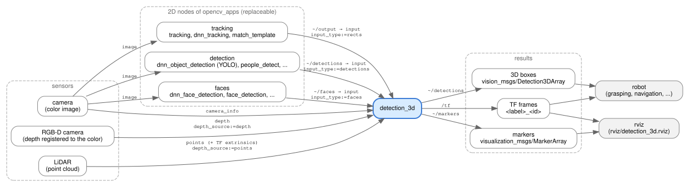

detection_3d
============

Publishes the 3D boxes (``vision_msgs/Detection3DArray``) and the TF frames ``<label>_<id>`` of the 2D results of the other nodes, ``~/detections`` of the detection nodes (``input_type:=detections``), ``~/faces`` of the face nodes (``faces``), ``~/output`` of the tracking nodes (``rects``) or ``~/skeletons`` of the pose nodes (``skeletons``, with the TF frames of the keypoints), with a depth image registered to their color image, e.g. of an RGB-D camera or ``~/depth`` of dnn_depth_estimation (``depth_source:=depth``), or a point cloud, e.g. of a LiDAR, transformed to the camera frame by TF (``depth_source:=points``). The points of a 2D box are the pixels of the depth image in the box or the points of the cloud projected into the box, the depth of the object is the median of their depths, and its 3D box is the extent of the points within ``depth_threshold`` of the median, as `yolo_ros <https://github.com/mgonzs13/yolo_ros>`_. The objects are tracked by the distance of their centers, so that each object keeps its TF frame. On ROS 1, the results of vision_msgs (0.0.2) have only the class id of the detections, and the labels are in the TF frames.

.. list-table::
   :stub-columns: 1

   * - opencv_apps
     - 3.1.0 and later
   * - ROS
     - ROS One, jazzy, kilted, lyrical and later
   * - OpenCV
     - any version of the distributions
   * - Group
     - Depth and 3D localization, the nodes of which publish ``~/inverse_depth`` or ``~/depth`` (Image) of dnn_depth_estimation, and ``~/detections`` (vision_msgs/Detection3DArray), ``~/markers`` (for rviz) and the TF frames of detection_3d

   The pipeline of detection_3d: the 2D results of the other nodes (replaceable by remapping input), the distances of an RGB-D camera or a LiDAR, and the 3D boxes, the markers and the TF frames of the objects.

.. image:: https://ros-perception.github.io/opencv_apps/media/detection_3d.gif
   :alt: demo of detection_3d

Usage
-----

.. code-block:: bash

   # ROS 2
   ros2 launch opencv_apps detection_3d.launch.xml input:=/dnn_object_detection/detections depth:=/camera/camera/aligned_depth_to_color/image_raw camera_info:=/camera/camera/color/camera_info
   # ROS 1
   roslaunch opencv_apps detection_3d.launch input:=/dnn_object_detection/detections depth:=/camera/aligned_depth_to_color/image_raw camera_info:=/camera/color/camera_info
   # ROS 2, with detection_3d: the 3D boxes and the TF frames of the detected objects, from the depth image registered to the color image (or, without depth:=, the depth estimated from the color image by dnn_depth_estimation), shown in rviz2
   ros2 launch opencv_apps dnn_object_detection.launch.xml image:=/camera/camera/color/image_raw depth:=/camera/camera/aligned_depth_to_color/image_raw detection_3d:=true rviz:=true

Try it with the demo video
--------------------------

Download the input of the demo above, publish it, and run the node on it, in the terminals:

.. code-block:: bash

   wget https://raw.githubusercontent.com/ros-perception/opencv_apps/indigo/test/publish_rgbd.py
   wget https://raw.githubusercontent.com/ros-perception/opencv_apps/indigo/test/rgbd_walking.mp4
   wget https://raw.githubusercontent.com/ros-perception/opencv_apps/indigo/test/rgbd_walking_depth.npz
   # terminal 1: publish the input in a loop
   python3 publish_rgbd.py rgbd_walking.mp4 rgbd_walking_depth.npz
   # terminal 2: run the detector, detection_3d and rviz2 in one launch file
   ros2 launch opencv_apps dnn_object_detection.launch.xml image:=/image depth:=/depth detection_3d:=true rviz:=true rviz_points:=/points

The input is 20 RGB-D images of the TUM RGB-D freiburg3_walking_xyz sequence (image, depth in mm, camera_info and the colored points, by test/publish_rgbd.py, with the static TF of the camera on camera_link), and the objects of dnn_object_detection. rviz/detection_3d.rviz shows the points, ~/markers (the 3D boxes, the labels with the distances and the axes of the TF frames of the objects), the image of dnn_object_detection and the depth image; for your camera, give its frame by ``fixed_frame``, e.g. ``fixed_frame:=camera_link`` (or by -f of rviz2 run by itself, with the topics of the images by remapping, e.g. --ros-args -r /depth:=/camera/camera/aligned_depth_to_color/image_raw). rviz/detection_3d_ros1.rviz is the same for ROS 1. Give the full names of the topics: ``depth:=depth`` is ``depth`` of the namespace of the node, and a camera may publish ``depth/image``, ``depth/image_raw`` or ``depth_registered/image_raw``. The node warns of an input of no publisher, with the published topics of its type, and of the inputs not received or not synchronized for 5 s.

What runs in the launch file
^^^^^^^^^^^^^^^^^^^^^^^^^^^^

``detection_3d:=true`` of dnn_object_detection.launch.xml (and of dnn_pose_estimation.launch.xml) includes launch/detection_3d_pipeline.launch.xml, which runs the pipeline of the figure above: the detector publishes the 2D results (``/dnn_object_detection/detections``), detection_3d (``dnn_object_detection_3d``) synchronizes them with ``depth`` and ``camera_info`` (``camera_info`` next to ``image`` by default) and publishes the 3D boxes, the markers and the TF frames, and rviz2 (``rviz:=true``) shows them with the image of the detector and the depth image; without ``depth``, dnn_depth_estimation (``dnn_object_detection_depth_estimation``, Depth Anything V2 Metric) estimates the depth from the color image. The same pipeline by the nodes, each in its own terminal, e.g. to change the parameters of each node or to use another detector (any node of the 2D results, with ``input_type``):

.. code-block:: bash

   # terminal 1: publish the input in a loop, as above
   # terminal 2: the detector, the 2D results on /dnn_object_detection/detections
   ros2 launch opencv_apps dnn_object_detection.launch.xml image:=/image
   # terminal 3: detection_3d, the 2D results and the depth to the 3D boxes and the TF frames
   ros2 launch opencv_apps detection_3d.launch.xml input:=/dnn_object_detection/detections depth:=/depth camera_info:=/camera_info
   # terminal 4: rviz2
   ros2 run rviz2 rviz2 -d $(ros2 pkg prefix --share opencv_apps)/rviz/detection_3d.rviz

See :doc:`../credits` for the license of the video.

Inputs and sources of the distances
-----------------------------------

The 2D results of the other nodes and the distances of an RGB-D camera, a monocular depth estimation or a LiDAR, shown in rviz with rviz/detection_3d.rviz and rviz/detection_3d_lidar.rviz (the view of the objects farther away). The commands below are in their own terminals, as above; the launch file of the detector with ``detection_3d:=true`` runs the pipeline (see above), and the nodes run each for the LiDAR.

Objects and an RGB-D camera (default)
^^^^^^^^^^^^^^^^^^^^^^^^^^^^^^^^^^^^^

.. image:: https://ros-perception.github.io/opencv_apps/media/detection_3d.gif
   :alt: demo of detection_3d with rgbd

.. code-block:: bash

   python3 publish_rgbd.py rgbd_walking.mp4 rgbd_walking_depth.npz &
   ros2 launch opencv_apps dnn_object_detection.launch.xml image:=/image depth:=/depth detection_3d:=true rviz:=true rviz_points:=/points

The depth image of the TUM RGB-D dataset, as above.

Human and hand skeletons
^^^^^^^^^^^^^^^^^^^^^^^^

.. image:: https://ros-perception.github.io/opencv_apps/media/detection_3d_skeletons.gif
   :alt: demo of detection_3d with skeletons

.. code-block:: bash

   python3 publish_rgbd.py rgbd_walking.mp4 rgbd_walking_depth.npz &
   ros2 launch opencv_apps dnn_pose_estimation.launch.xml image:=/image depth:=/depth detection_3d:=true rviz:=true rviz_points:=/points

``~/skeletons`` of dnn_pose_estimation (``person``) or dnn_hand_pose_estimation (``left_hand`` and ``right_hand``): the box and the TF frame of each skeleton as an object, the TF frame ``<label>_<id>_<keypoint>`` of each keypoint (e.g. ``person_0_left_wrist``) at the median depth within ``keypoint_radius`` of the keypoint, and the joints and the bones in ``~/markers``; the keypoints less visible than ``keypoint_visibility`` are left out. Needs OpenCV 4.9 or later, as the pose nodes.

Monocular depth estimation
^^^^^^^^^^^^^^^^^^^^^^^^^^

.. image:: https://ros-perception.github.io/opencv_apps/media/detection_3d_mono.gif
   :alt: demo of detection_3d with mono

.. code-block:: bash

   python3 publish_rgbd.py rgbd_walking.mp4 rgbd_walking_depth.npz --ros-args -r depth:=unused_depth -r points:=unused_points &
   ros2 launch opencv_apps dnn_object_detection.launch.xml image:=/image detection_3d:=true rviz:=true use_cuda:=true

Only the color image of a camera: without ``depth``, the launch file runs dnn_depth_estimation with Depth Anything V2 Metric (indoors, see dnn_depth_estimation), whose ``~/depth`` (32FC1 in m) detection_3d uses instead of the depth of the RGB-D camera (not used, remapped to unused_depth); ``use_cuda:=true`` runs the detector and the depth estimation in the docker image of OpenCV with CUDA (see :doc:`../gpu`). The points of the estimated depth for rviz are by depth_image_proc, e.g. ``ros2 run depth_image_proc point_cloud_xyzrgb_node --ros-args -r rgb/image_rect_color:=/image -r rgb/camera_info:=/camera_info -r depth_registered/image_rect:=/dnn_object_detection_depth_estimation/depth`` with ``rviz_points:=/points``. The distances are less accurate than those of an RGB-D camera (the relative error is about 0.15 on CUDA in this sequence), and the model needs OpenCV 4.10 or later, and a GPU to run it in real time.

LiDAR
^^^^^

.. image:: https://ros-perception.github.io/opencv_apps/media/detection_3d_lidar.gif
   :alt: demo of detection_3d with lidar

.. code-block:: bash

   wget https://raw.githubusercontent.com/ros-perception/opencv_apps/indigo/test/publish_lidar.py
   wget https://raw.githubusercontent.com/ros-perception/opencv_apps/indigo/test/lidar_boreas.mp4
   wget https://raw.githubusercontent.com/ros-perception/opencv_apps/indigo/test/lidar_boreas_points.npz
   python3 publish_lidar.py lidar_boreas.mp4 lidar_boreas_points.npz &
   ros2 launch opencv_apps dnn_object_detection.launch.xml image:=image &
   ros2 run rviz2 rviz2 -d $(ros2 pkg prefix --share opencv_apps)/rviz/detection_3d_lidar.rviz &
   ros2 launch opencv_apps detection_3d.launch.xml input:=/dnn_object_detection/detections points:=points camera_info:=camera_info depth_source:=points depth_threshold:=1.0 max_depth:=60.0 track_distance:=2.0

20 images and the points of the LiDAR (in the frame lidar, with the static TF of the extrinsics from the frame camera) of the Boreas dataset, by test/publish_lidar.py; the objects are farther and move faster than indoors, so max_depth, depth_threshold and track_distance are larger.

Subscribed topics
-----------------

.. list-table::
   :header-rows: 1

   * - Topic
     - Type
   * - ``camera_info``
     - ``sensor_msgs/msg/CameraInfo``
   * - ``depth``
     - ``sensor_msgs/msg/Image``
   * - ``input``
     - :ref:`opencv_apps/msg/DetectionArrayStamped <msg-DetectionArrayStamped>`

Published topics
----------------

.. list-table::
   :header-rows: 1

   * - Topic
     - Type
   * - ``~/detections``
     - ``vision_msgs/msg/Detection3DArray``
   * - ``~/markers``
     - ``visualization_msgs/msg/MarkerArray``
   * - ``/tf``
     - ``tf2_msgs/msg/TFMessage``

Parameters
----------

See also the :ref:`common parameters <common-parameters>`.

.. list-table::
   :header-rows: 1

   * - Name
     - Type
     - Default (range)
     - Changed at run time
     - Description
   * - ``depth_source``
     - string
     - "depth"
     - no, restart the node
     - Source of the distances: depth (the depth image registered to the color image, 16UC1 in mm or 32FC1 in m, e.g. of an RGB-D camera) or points (a point cloud, e.g. of a LiDAR, transformed to the frame of camera_info by TF).
   * - ``depth_threshold``
     - double
     - 0.3 (0.01 - 10)
     - yes
     - The points within this distance (m) of the median depth of the box belong to the object.
   * - ``face_confidence``
     - string
     - "probability"
     - yes
     - The confidence of the faces (input_type faces): probability (e.g. dnn_face_detection, dnn_face_recognition), the score in [0, 1], or distance (face_recognition, smaller is better), whose score is 1 / (1 + distance)
   * - ``input_type``
     - string
     - "detections"
     - no, restart the node
     - Type of input: detections (opencv_apps/DetectionArrayStamped, e.g. ~/detections of dnn_object_detection), faces (FaceArrayStamped, ~/faces of the face nodes), rects (RectArrayStamped, ~/output of the tracking nodes) or skeletons (SkeletonArrayStamped, ~/skeletons of dnn_pose_estimation and dnn_hand_pose_estimation, with the TF frames of the keypoints).
   * - ``keypoint_radius``
     - int
     - 3 (0 - 50)
     - yes
     - The depth of a keypoint of a skeleton is the median of the depths of the pixels (or the points projected) within this distance (pixels) of the keypoint.
   * - ``keypoint_visibility``
     - double
     - 0.5 (0 - 1)
     - yes
     - Minimum visibility of a keypoint of a skeleton to be localized.
   * - ``max_depth``
     - double
     - 10.0 (0 - 1000)
     - yes
     - Maximum valid depth (m).
   * - ``min_depth``
     - double
     - 0.1 (0 - 100)
     - yes
     - Minimum valid depth (m).
   * - ``publish_tf``
     - bool
     - true
     - yes
     - Publish the TF frame <tf_prefix><label>_<id> of each object; with it at the start, the node subscribes the inputs always, for the subscribers of /tf.
   * - ``queue_size``
     - int
     - 10
     - no, restart the node
     - Queue size of the synchronized subscribers.
   * - ``rectified``
     - bool
     - false
     - yes
     - The 2D results are of the rectified image (e.g. image_rect), of P and R (the rotation from the optical frame) of camera_info, instead of the raw image with the distortion of K and D
   * - ``roi_scale``
     - double
     - 0.8 (0.1 - 1)
     - yes
     - Scale of the 2D box whose depths are used, smaller to leave out the background at the edges of the box.
   * - ``tf_prefix``
     - string
     - ""
     - yes
     - Prefix of the TF frames.
   * - ``track_distance``
     - double
     - 0.5 (0 - 10)
     - yes
     - An object within this distance (m) of an object of the same label in the previous images is the same object, and keeps its id.
   * - ``track_lost_frames``
     - int
     - 10 (0 - 1000)
     - yes
     - Number of images that a lost object keeps its id for.

Source
------

`src/nodelet/detection_3d_nodelet.cpp <https://github.com/ros-perception/opencv_apps/blob/indigo/src/nodelet/detection_3d_nodelet.cpp>`_, 
`launch/detection_3d.launch.xml <https://github.com/ros-perception/opencv_apps/blob/indigo/launch/detection_3d.launch.xml>`_
